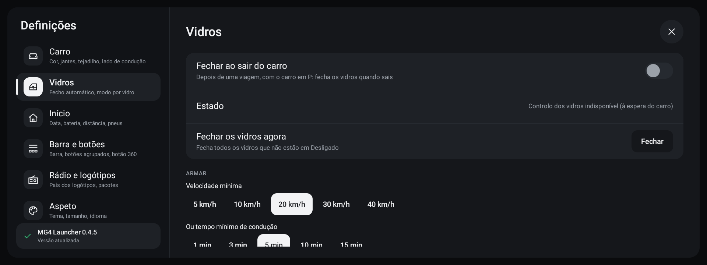
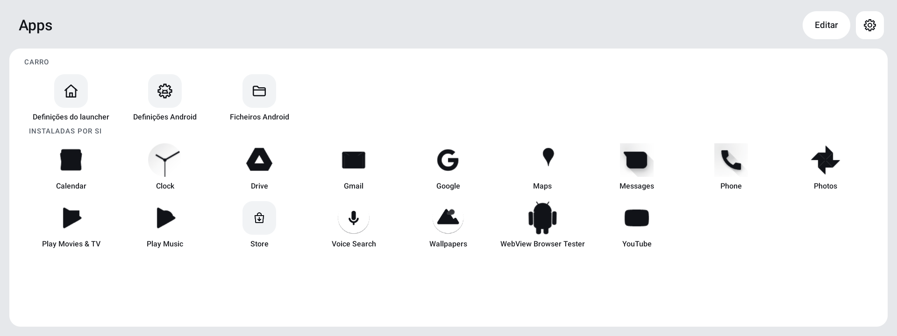

> [!WARNING]
> **Para remover o launcher usa sempre Definições → Desinstalar do launcher**, não o menu Apps do Android. Se o carro ficar em "Smartphone starting", instala o [MG4 Ripristino Home](https://github.com/ernestomicco2026-cell/Mg4-Launcher-SWI68/raw/main/releases/MG4HomeRescue-1.0.apk) a partir de uma pen USB e abre-o: volta a ligar o ecrã inicial original.

# MG4 Launcher — SWI69 Color Radio

<p align="center"></p>

<p align="center">
<b>Launcher em estilo Tesla para o sistema de infoentretenimento MG4 SWI69 Color Radio</b>
</p>

<p align="center">
<a href="releases/MG4Launcher-SWI69-0.4.9.apk"></a>
<a href="https://paypal.me/ErnestoMicco?locale.x=it_IT&country.x=IT"></a>
</p>

<p align="center">
<a href="#que-versão-instalar">Que versão instalar?</a> ·
<a href="#o-que-faz">O que faz</a> ·
<a href="#instalação">Instalação</a> ·
<a href="#sobre-este-fork">Sobre este fork</a> ·
<a href="#versões">Novidades</a>
</p>

> ⚠️ **Compatibilidade:** apenas infoentretenimento **SWI69 Color Radio**.
> De momento garantido no **MG4 standard MY23 R45**; como usa os dados da FICM original, deverá funcionar em todas
> as versões com **Color Radio**.
> Para os outros softwares usa a versão dedicada:
> **SWI68 SAIC 1.0+** → [Mg4-Launcher-SWI68](https://github.com/ernestomicco2026-cell/Mg4-Launcher-SWI68) ·
> **SWI132 (MG4 MY24)** → [Mg4-Launcher-SWI132](https://github.com/ernestomicco2026-cell/Mg4-Launcher-SWI132) ·
> **SWI133 (MG4 Luxury MY24)** → [Mg4-Launcher-SWI133](https://github.com/ernestomicco2026-cell/Mg4-Launcher-SWI133)

---

## Sobre este fork

Este repositório é um **fork** do [MG4 Launcher SWI69](https://github.com/ernestomicco2026-cell/Mg4-Launcher-SWI69) de
**Ernesto Micco** ([ernestomicco2026-cell](https://github.com/ernestomicco2026-cell)), autor do launcher original.
A partir da **0.4.6** acrescenta funções novas, baseadas no trabalho de outros projetos da comunidade MG4:

| Função | Onde fica no launcher | Proveniente de |
|---|---|---|
| **Vidros**: fecho automático ao sair do carro (velocidade/tempo para armar, atraso, bip, modo por vidro) e fecho manual | Definições → **Vidros** | [**WinClose**](https://github.com/Skittle6938/winclose), de [Skittle6938](https://github.com/Skittle6938) |
| **Aquecimento inteligente da bateria** (ligar/desligar) | Barra de baixo → grupo **Condução** | [**MG4Control**](https://github.com/SliDeeN/MG4Control), de [SliDeeN](https://github.com/SliDeeN) |
| Atalho **Definições do launcher** | Separador **Apps** → secção Carro | este fork |

As funções foram **reescritas em Java** para o launcher, com o grafismo do launcher: não incluem código copiado desses
projetos. O mérito da descoberta de como o carro funciona (serviços SAIC, comandos dos vidros, sensor da porta,
propriedade do aquecimento da bateria) é dos respetivos criadores. Se gostas destas funções, visita e apoia os
repositórios originais.

> ⚠️ As funções novas foram testadas no emulador (interface e lógica); o comando dos vidros e o aquecimento da bateria
> precisam de confirmação no carro. Se algo não funcionar, abre um *issue* neste repositório com o texto de
> **Definições → Sistema → Diagnóstico** (linhas `vidros.*` e `bateria.aquecimento`).

As atualizações automáticas desta versão vêm **deste fork** (não da versão original).

---

## Capturas de ecrã

<table>
<tr>
<td width="50%" valign="top"><br>
<sub>Tema <b>dia</b> com o rádio: <b>FM/DAB</b> por baixo de Rádio, <b>Mapa/Multimédia</b> em baixo antes dos favoritos</sub></td>
<td width="50%" valign="top"><br>
<sub><b>Animação de carregamento</b>: o carro roda, o cabo encaixa e a carga flui; potência ao lado da temperatura</sub></td>
</tr>
<tr>
<td width="50%" valign="top"><br>
<sub>Tema <b>noite</b> com o rádio e a lista de estações</sub></td>
<td width="50%" valign="top"><br>
<sub>Fonte <b>USB</b>: botões das fontes maiores, cada um com o seu fundo</sub></td>
</tr>
<tr>
<td width="50%" valign="top"><br>
<sub>Painel <b>Mapa</b>: navega-se com CarPlay ou Android Auto, Mapa/Multimédia em baixo à esquerda</sub></td>
<td width="50%" valign="top"><br>
<sub>Tamanho dos comandos <b>Grande</b>: texto e botões crescem em conjunto</sub></td>
</tr>
<tr>
<td width="50%" valign="top"><br>
<sub>Tamanho dos comandos <b>Grande</b>, de noite</sub></td>
<td width="50%" valign="top"><br>
<sub>Tamanho dos comandos <b>Muito grande</b>, de noite: todas as fontes mantêm o nome</sub></td>
</tr>
<tr>
<td width="50%" valign="top"><br>
<sub>Tamanho dos comandos <b>Muito grande</b>, de dia</sub></td>
<td width="50%" valign="top"><br>
<sub>Grupo <b>Condução</b>: faixa, One Pedal, assistente, pedal do travão</sub></td>
</tr>
<tr>
<td width="50%" valign="top"><br>
<sub>Grupo <b>Climatização</b>: A/C, automático, recirculação</sub></td>
<td width="50%" valign="top"><br>
<sub><b>Definições</b>: cor, jantes e tejadilho do carro</sub></td>
</tr>
<tr>
<td width="50%" valign="top"><br>
<sub><a href="https://github.com/ernestomicco2026-cell/HVAC-Clima-MG4">MG4 Clima</a> aberto a partir do botão da climatização</sub></td>
<td width="50%" valign="top"><br>
<sub><b>Vidros</b> (0.4.6, fork): fecho automático ao sair do carro, baseado no <a href="https://github.com/Skittle6938/winclose">WinClose</a></sub></td>
</tr>
<tr>
<td width="50%" valign="top"><br>
<sub>Separador <b>Apps</b> (0.4.6, fork): atalho <b>Definições do launcher</b></sub></td>
<td width="50%" valign="top"></td>
</tr>
</table>

<sub>Simulações do grafismo: valores, estações e logótipos são exemplos.</sub>

> 🌡️ **Novo: [MG4 Clima](https://github.com/ernestomicco2026-cell/HVAC-Clima-MG4)** — o ecrã da climatização em estilo Tesla, para SWI68, SWI69, SWI132 e SWI133. Com o MG4 Clima instalado, o botão da climatização do launcher abre-o diretamente.

---

## Que versão instalar?

Há **um launcher diferente para cada software** do infoentretenimento MG4. Não são intercambiáveis:
os serviços do carro, rádio, multimédia e climatização são diferentes e, com a versão errada, o launcher abre mas não lê
nada do carro ("Serviço do veículo indisponível").

| Software do carro | Carro | Repositório | Ficheiro APK |
|---|---|---|---|
| **SWI68 SAIC 1.0+** | MG4 | [Mg4-Launcher-SWI68](https://github.com/ernestomicco2026-cell/Mg4-Launcher-SWI68) | `MG4Launcher-X.Y.Z.apk` |
| **SWI69 Color Radio** | MG4 MY23 | **este repositório** | `MG4Launcher-SWI69-X.Y.Z.apk` |
| **SWI132** | MG4 MY24 | [Mg4-Launcher-SWI132](https://github.com/ernestomicco2026-cell/Mg4-Launcher-SWI132) | `MG4Launcher-SWI132-X.Y.Z.apk` |
| **SWI133** | MG4 Luxury MY24 | [Mg4-Launcher-SWI133](https://github.com/ernestomicco2026-cell/Mg4-Launcher-SWI133) | `MG4Launcher-SWI133-X.Y.Z.apk` |

**Como saber que software tens:** com o computador ligado ao carro,
`adb shell getprop ro.build.mt2712.version` → começa por `SWI68-`, `SWI69-`, `SWI132-` ou `SWI133-`: é o software do teu carro.
Se o launcher já estiver instalado: definições → linha **MG4 Launcher X.Y.Z · repositório** em *Atualizações*;
o nome do repositório diz que versão tens. Se no *Diagnóstico* aparecerem `veicolo.bind = fallito` e
`media.usb.bind = fallito`, instalaste a versão SWI68 num carro SWI69 (ou vice-versa).

---

## Vídeo de análise

<a href="https://youtu.be/JKZ0N3Lr7FI"></a>

Vê o [vídeo de análise no YouTube](https://youtu.be/JKZ0N3Lr7FI).

---

## Português

Launcher em estilo Tesla para o infoentretenimento do **MG4** com o software **SWI69 Color Radio**
(EH32, Android Automotive 9, build `SWI69-29958-1100R45`).

**Compatibilidade:** funciona **apenas com o software SWI69 Color Radio**. O SWI69 Color Radio não é uma atualização
do SWI68: é um software diferente, com outros serviços do carro. No SWI68 usa a [versão SWI68](https://github.com/ernestomicco2026-cell/Mg4-Launcher-SWI68).
Substitui o ecrã inicial original mantendo as suas funções, com o mesmo grafismo da versão SWI68.

**Versões do carro:** de momento a compatibilidade está **garantida no MG4 standard MY23 com software R45**
(`SWI69-29958-1100R45`), onde o launcher foi testado. Como usa os mesmos dados e serviços da **FICM**
original (a unidade de infoentretenimento), deverá funcionar em **todas as versões com o rádio Color Radio**.
Se o experimentares noutra versão, os relatos são bem-vindos: abre um *issue* com o registo guardado (ver [Reportar um problema](#reportar-um-problema)).

**Índice:** [O que faz](#o-que-faz) · [Instalação](#instalação) · [Atualizações](#atualizações) · [Voltar ao ecrã inicial MG original](#voltar-ao-ecrã-inicial-mg-original) · [Comandos úteis](#comandos-úteis) · [Reportar um problema](#reportar-um-problema) · [Apoiar o projeto](#apoiar-o-projeto) · [Versões](#versões)

### O que faz

- **Vidros** (0.4.6, fork, baseado no [WinClose](https://github.com/Skittle6938/winclose)): depois de uma viagem, com o
  carro em P, fecha os vidros quando o condutor sai (ao abrir ou ao fechar a porta, com atraso e bip configuráveis);
  arma-se acima de uma velocidade ou depois de um tempo de condução; cada vidro em Auto, Pulso ou Desligado; botão
  **Fechar os vidros agora**. A contagem cancela-se ao reabrir a porta, sair de P, ligar o carro ou mexer num vidro.
  Vem desligado: ativa-se em Definições → Vidros.
- **Aquecimento inteligente da bateria** (0.4.6, fork, baseado no [MG4Control](https://github.com/SliDeeN/MG4Control)):
  botão no grupo **Condução** da barra. Melhora o carregamento rápido mas reduz a autonomia e não se desliga sozinho.
- **Atalho Definições do launcher** (0.4.6, fork) no separador Apps, além da pressão longa sobre o carro.
- **Carro e bateria** (à esquerda): autonomia e **relógio** em grande, barra da bateria com a percentagem ao lado e
  marca do limite de carga, temperatura exterior; o estado só aparece durante o carregamento ou com V2L (tipo, potência,
  tempo restante). Nas definições ativam-se a **data** ao lado da hora, a percentagem com uma casa decimal, a pressão
  dos pneus (TPMS) com escolha da unidade (como no quadrante, bar, kPa ou psi) e os **botões de carregamento**
  (limite de carga, corrente AC e iniciar/parar o carregamento ou o V2L, com confirmação). O teu MG4, que pode ser
  pintado com as 8 cores de fábrica, com tejadilho preto opcional.
  Toca no carro ou no V2L → app Energia. Toque longo no carro → definições do launcher.
- **Mapa / Multimédia / CarPlay** (à direita):
  - **Mapa**: o SWI69 não tem navegador MG, a navegação faz-se com **CarPlay / Android Auto**. Sem navegação ativa, um
    cartão mostra o estado do telemóvel com um botão **Abrir CarPlay / Android Auto** (ou um lembrete para ligares o
    telemóvel); durante a navegação, o painel mostra as indicações do telemóvel.
  - **Multimédia**: abre na fonte que está a tocar, caso contrário no rádio; um botão por fonte em cima
    (Rádio, USB, Bluetooth, Online quando disponível, mais CarPlay/Android Auto quando há um telemóvel ligado);
    com mais de 4 fontes, as não selecionadas mostram só o ícone.
    Rádio: o **logótipo** da estação na capa (o nome só quando não há logótipo), **favoritos** e, à direita,
    **FM / DAB** com a **lista de estações** (DAB a partir do serviço de rádio, FM a partir de uma pesquisa e das estações
    que ouviste). Toca numa estação para a sintonizar, toque longo para a adicionar/remover dos favoritos.
    **Logótipos de rádio**: os teus na pasta **MG4Launcher/loghi** (ex. `MG4Launcher/loghi/NOME.png`, na memória ou
    numa pen USB: têm prioridade), os enviados pelas estações DAB e os transferidos quando há ligação, guardados para
    sempre e reutilizados sem ligação.
  - **CarPlay / Android Auto**: o separador aparece sozinho quando ligas um telemóvel.
  - Em cima à direita, antes dos separadores, uma pastilha com **Bluetooth** (cheio = telemóvel ligado, esbatido = ligado
    mas sem telemóvel) e **Wi-Fi** com 4 barras de sinal (só quando ligado).
- **Barra inferior**, com comandos grandes para usar durante a condução: temperatura ‹ › (LO, 16…30, HI) e ventilação ‹ ›
  (OFF / 1…11 / A = automático; toque no número = app Climatização, toque longo = climatização ligada/desligada),
  botões **A/C** e **AUTO** (ligado = cores invertidas), **recirculação** de 3 estados (Interior / Exterior / Auto, só se o
  carro o suportar), grupo **Condução** (LKA, One Pedal, assistente Off/ACC/TJA e pedal do travão, só os comandos que o
  carro tem), mini leitor compacto, **farol de nevoeiro traseiro** (âmbar quando ligado; Automático = escondido se a barra
  do sistema já mostrar o seu indicador, ou Mostrar / Esconder) e **faróis de nevoeiro dianteiros** (verde, só se
  existirem), Telefone, Rádio, **360°** (câmaras), Definições. Com a **barra grande** (opção), os botões da climatização
  ficam maiores e o mini leitor dá lugar (a música fica no painel Multimédia).
- **Apps**: desliza o ecrã inicial para a esquerda para ver as apps do carro e as que instalares; desliza para a direita
  para voltar. Usa **Editar** para escolher que apps mostrar, incluindo as do carro. No fim das apps do carro estão também
  as **Definições Android** e os **Ficheiros Android** (só se existirem no carro).
- **Tamanho dos comandos** (Normal / Grande / Muito grande): aumenta botões, ícones e textos dos botões
  proporcionalmente, para facilitar o uso durante a condução.
- **Volante à direita ou à esquerda**: automático a partir da configuração do carro ou escolhido nas definições; com
  volante à direita o ecrã inicial fica espelhado, com o carro e a climatização do lado do condutor. Nos carros que
  mostram sempre o indicador de luzes do sistema no canto superior esquerdo, esse canto fica livre.
- **Definições** (toque longo no carro), divididas em secções com um menu lateral: **Carro** (cor, tejadilho preto),
  **Início** (casas decimais, pressão dos pneus), **Aspeto** (tema, tamanho dos comandos, idioma),
  **Condução** (lado de condução, ecrã inicial MG original), **Sistema** (atualizações, gravação de registos,
  diagnóstico). A versão e, quando disponível, uma nova versão com **Instalar** aparecem sempre no fundo do menu.
  Também acessíveis pela roda dentada em cima à direita da página Apps.
- **Ecrã inteiro**: barra de estado e dock MG escondidas (desliza a partir da margem para as fazer voltar).
- **Atualizações**: as novas versões transferem-se e instalam-se a partir das definições, sem computador. Quando sai uma,
  aparece em baixo à direita um pequeno aviso com **Atualizar** / **Mais tarde** (esconde-se sozinho; "Mais tarde"
  espera um dia).
- **Música que retoma sozinha**: se uma notificação do telemóvel fizer a música Bluetooth (ou USB / online) passar para
  o rádio, o launcher retoma a tua música após alguns segundos. Não faz nada se foste tu a escolher o rádio.
- **Sem envio de registos**: nesta versão (fork) o envio automático de registos está **desligado de forma permanente**.
  O launcher não envia diagnósticos para nenhum servidor; **Guardar registo** grava o registo apenas no carro, em
  `Download/MG4Launcher/`, e na pen USB, em `MG4Launcher/registos/`, para o anexares tu a um *issue* se quiseres.
- **Arranque ao ligar**: o launcher volta sozinho para a frente se o sistema abrir o ecrã inicial MG; além disso, a opção
  **Premir Início sozinho após ligar** (desligada, 5, 10, 15, 20 ou 30 segundos), apenas uma vez e só por cima do ecrã
  inicial MG.
- **Novidades**: no primeiro arranque após uma atualização, uma janela mostra brevemente as novidades (uma vez por versão).

**Idiomas:** italiano, inglês, espanhol, alemão, português, francês, turco e polaco. **Como o carro** (predefinido) segue
o idioma do sistema e atualiza-se sozinho quando o mudas no carro; em alternativa escolhe um idioma nas definições.
Os outros idiomas do sistema passam para inglês.

### Instalação

Apenas para o infoentretenimento **SWI69 Color Radio**. Transfere o APK da pasta [`releases/`](releases/).
Há duas formas de o instalar: a partir de uma pen USB, se conseguires abrir um gestor de ficheiros no carro, ou com adb
a partir de um computador.

#### Método 1 — A partir de uma pen USB (sem computador)

Tens de conseguir abrir um gestor de ficheiros no infoentretenimento.

1. Copia `MG4Launcher-SWI69-0.4.9.apk` para uma pen USB formatada em **FAT32** ou **exFAT**.
2. Liga-a ao carro, abre o gestor de ficheiros e toca no APK.
3. Se o Android disser que não pode instalar apps desta origem: toca em **Definições**, ativa
   **Permitir desta origem** para o gestor de ficheiros e volta atrás.
4. Toca em **Instalar**.
5. Prime o botão **Início**: o Android pergunta que app de ecrã inicial usar. Escolhe **MG4 Launcher** e depois **Sempre**.

Se **Definições** não fizer nada ou a instalação falhar, usa o método 2 (e, se puderes, reporta a mensagem de erro).

#### Método 2 — Com adb a partir de um computador

Precisas de um computador com o [adb](https://developer.android.com/tools/releases/platform-tools) ligado ao carro.
O firmware MG pode bloquear a instalação normal de apps; a opção `-f` permite-a.

1. Instala:
   ```bash
   adb install -r -f MG4Launcher-SWI69-0.4.9.apk
   ```
2. Define-o como ecrã inicial predefinido:
   ```bash
   adb shell cmd package set-home-activity com.mg4.launcher/.MainActivity
   ```
   Ou prime o botão Início: o Android pergunta que app de ecrã inicial usar.

> **Se ao premir Início não te perguntar que ecrã inicial usar** (nalguns SWI69 o botão abre diretamente o ecrã
> inicial MG): não é preciso fazer mais nada, o launcher passa a substituir sozinho o ecrã inicial MG sempre que este
> aparece. Se tiveres uma app que remapeia os botões (ex. **MG4 Control**), confirma que o botão Início não está
> atribuído ao ecrã inicial MG.

Em ambos os casos, o launcher passa a arrancar sozinho quando o carro liga, tal como o ecrã inicial original,
e as atualizações seguintes instalam-se a partir das definições do launcher, sem pen USB nem computador.

### Atualizações

Definições do launcher → **Sistema** → **Atualizações** → **Verificar**.
Se existir uma versão mais recente aparece **Instalar** (também no fundo do menu das definições): o launcher instala-a e
reinicia. O carro precisa de ligação à internet (conectividade do carro ou hotspot do telemóvel). As atualizações vêm
apenas deste repositório: nunca é proposta uma versão SWI68. Quem tiver uma versão anterior à 0.1.3 tem de instalar
manualmente uma mais recente uma vez (pen USB ou adb).

A partir da 0.4.2 o launcher **procura atualizações sozinho**: 2 minutos após o arranque e depois a cada 6 horas. Quando
existe uma nova versão aparece um aviso discreto com um botão **Atualizar**. Para correções importantes a atualização
pode começar sozinha, mas só com o carro parado. O launcher pode também mostrar **avisos importantes** (por exemplo, um
problema conhecido e como o resolver). Só lê ficheiros deste repositório.

### Voltar ao ecrã inicial MG original

A partir do launcher: definições → **Abrir o ecrã inicial original MG**. Para voltar a defini-lo como predefinido:

```bash
adb shell cmd package set-home-activity com.saicmotor.launcher/.view.MainActivity
```

Para remover completamente o launcher, mesmo sem computador (desde a 0.3.3): definições → **Desinstalar MG4 Launcher**.
Repõe o ecrã inicial MG original e remove o launcher do carro. A partir de um computador: `adb uninstall com.mg4.launcher`.
A app original nunca é modificada.

### Comandos úteis

```bash
# reiniciar o launcher sem desligar o carro
adb shell am force-stop com.mg4.launcher
adb shell am start -n com.mg4.launcher/.MainActivity

# ver os valores lidos do carro (Ctrl+C para parar)
adb logcat -s MG4L MG4L.Link

# transferir o diagnóstico guardado pelo launcher (atualizado a cada 15 s)
adb pull /sdcard/Android/data/com.mg4.launcher/files/diagnostica.txt
```

### Reportar um problema

Definições → **Diagnóstico dos serviços do carro** mostra os valores em bruto lidos de cada serviço do carro e os erros
recentes; **Guardar registo** escreve um registo completo em **`Download/MG4Launcher/`** (memória do carro, visível no
gestor de ficheiros) e, com uma pen USB ligada, em **`MG4Launcher/registos/`** na raiz da pen: é a forma mais
rápida de corrigir aquilo que não funciona.

### Apoiar o projeto

O MG4 Launcher é e continuará a ser **gratuito**. Se te for útil e quiseres contribuir para as horas passadas a
desenvolvê-lo e a testá-lo no carro, podes deixar um donativo: é totalmente **voluntário** e **não há valor mínimo**,
podes dar o que quiseres. Uma estrela no repositório ou um relato de erro também ajudam muito. Obrigado!

Mesmo só **2 €** são uma grande ajuda para continuar a desenvolver e testar novas versões no carro.

[](https://paypal.me/ErnestoMicco?locale.x=it_IT&country.x=IT)

### Versões

#### 0.4.9 (fork InfectedM)
- **Vidros no SWI69 sem a função antiga**: em alguns firmwares o `CarVehicleSettingClient` já não tem
  `setVehicleWindowStatus(int,int)` (o estado ficava em "à espera do carro"). Agora os vidros passam a ser comandados
  pelas propriedades do CarService (`VEHICLE_DRIVERWINDOW`…), como no [MG4Control](https://github.com/SliDeeN/MG4Control)
  de SliDeeN. Só o vidro do condutor tem subida automática e sensor de posição; nos outros usa-se o modo Pulso.
- Estado mais claro ("não suportado por este firmware") e diagnóstica `vidros.carapi.metodos` com as funções do firmware.
- Janela **Novidades** da 0.4.9.

#### 0.4.8 (fork InfectedM)
- **Barra de baixo mais perto do condutor**: nevoeiro e atalhos (telefone, rádio, 360°, definições, CarPlay/Android
  Auto) passam para o centro, logo a seguir ao clima; o mini-player (ou os favoritos/atalhos que o substituem) vai
  para a direita. Com guia à direita a barra continua espelhada.
- **Atalhos mais espaçados** (tamanho Normal, botões agrupados): botões do meio mais largos e afastados (menos toques
  no botão do lado), mini-player mais estreito e divisórias entre secções mais visíveis.
- Janela **Novidades** da 0.4.8.

#### 0.4.7 (fork InfectedM)
- **Vidros mais leves**: com o fecho automático desligado (por omissão) o launcher já não lê o estado do carro em
  segundo plano (antes: 8–10 chamadas por segundo, sempre); ligado, o ritmo adapta-se (0,5 s só durante a contagem,
  2 s em READY, 5 s parado) e a porta continua a chegar na hora.
- **MG4 Store opcional**: o `build.sh` compila sem `tools/MG4Store.apk` e o botão "Instalar MG4 Store" só aparece
  quando o APK traz o Store.
- Os textos novos (Vidros, bateria, novidades) passam para o gerador `tools/i18n.py` / `tools/i18n_pl.py`.
- **Menos memória** (cerca de 8–12 MB a menos no total, sem mudar o aspeto):
  - logótipos de rádio: listas e favoritos usam miniaturas de 96 px e as caches passam a ter limite (antes todos a
    192 px, sem limite e para sempre); imagens grandes (pasta do utilizador, favicons, arte DAB) descodificadas já
    reduzidas;
  - capa da música e logótipo DAB: deixam de ser pedidos e recriados a cada segundo (passam a vir só quando mudam);
  - tejadilho preto e luzes do carro: recortes de poucos KB em vez de telas inteiras de 958×368 (~2,5 MB fixos a menos),
    imagem igual;
  - animação de carregamento: fotogramas guardados a 902×275 em vez de 1312×400 (o tamanho em que aparecem no ecrã):
    ~3 MB a menos durante a animação, metade do trabalho de descodificação e 18 MB em disco em vez de ~30 MB por cor
    (os fotogramas antigos são apagados e refeitos sozinhos uma vez).
- **Downloads a partir do fork**: as animações de carregamento e os pacotes de logótipos passam a ser descarregados
  deste repositório (antes vinham do repositório original). Os ficheiros e os SHA-256 são os mesmos.
- **Aspeto e toque**:
  - tema de dia: aviso de pressão baixa dos pneus, nevoeiro traseiro e dianteiro ligados e aquecimento com cores
    legíveis (antes com contraste de 1,6–2,3:1; o nevoeiro traseiro ligado tem agora fundo âmbar claro);
  - zonas de toque maiores sem mudar o desenho: botão "Procurar" do rádio, play/seguinte do mini-leitor (altura toda
    da barra) e separadores Mapa/Media;
  - definições: a linha inteira liga/desliga o interruptor, o estado desligado tem contorno e a bola desliza;
    esbatimento nas bordas do menu e do conteúdo (mostra que há mais secções) e o menu abre já na secção escolhida;
  - pop-ups Clima/Conforto/Condução e diálogos com transição suave (150 ms), sem aceitar um segundo toque enquanto
    fecham.
- Janela **Novidades** da 0.4.7.

#### 0.4.6 (fork InfectedM)
- **Vidros** (novo, baseado no [WinClose](https://github.com/Skittle6938/winclose) de Skittle6938): nova secção
  Definições → Vidros com fecho automático ao sair do carro (velocidade 5–40 km/h ou tempo 1–15 min para armar; contagem
  ao abrir ou ao fechar a porta do condutor; atraso 0–30 s; bip com volume; modo Auto / Pulso / Desligado por vidro) e
  botão **Fechar os vidros agora**. Funciona também com o launcher em segundo plano. Vem desligado.
- **Aquecimento inteligente da bateria** (novo, baseado no [MG4Control](https://github.com/SliDeeN/MG4Control) de
  SliDeeN): botão no grupo Condução da barra, com aviso ao ligar (não se desliga sozinho).
- **Atalho Definições do launcher** no separador Apps (secção Carro).
- **Atualizações** passam a vir deste fork (InfectedM/Mg4-Launcher-SWI69).
- Segurança: o código das bibliotecas SAIC usadas pelos Vidros só é carregado a partir de apps de sistema do carro.
- Textos novos nos 8 idiomas. Esta versão não inclui o MG4 Store integrado.
- **Envio de registos desligado de forma permanente**: nada é enviado para nenhum servidor (a opção e o botão "Enviar
  registo" foram retirados; registos que tenham ficado em fila de uma versão anterior são apagados).
- **Guardar registo** em pastas visíveis: `Download/MG4Launcher/` na memória do carro e `MG4Launcher/registos/` na raiz da
  pen USB (antes ficava em `Android/data/…`, que o gestor de ficheiros do carro não mostra).
- Janela **Novidades** da 0.4.6 com as novidades reais (mostrava uma lista antiga).

#### 0.4.5
- **Animação de carregamento**: agora arranca também com o ecrã ligado e o carro estacionado em P. A versão 0.4.4
  confundia a ignição ligada com READY e mantinha-a sempre parada. O READY passa a ser lido do seu sinal real
  (SENSOR_EPTRDY): a animação só para em READY, em andamento ou numa mudança diferente de P.
- **Cabo ligado**: se a tomada disser "desligado" mas o estado de carregamento disser "cabo ligado", o cabo conta como
  ligado (a discordância vai para o registo).
- Verificação de funções: novo teste "READY lido". Textos verificados nos 8 idiomas.

#### 0.4.4
- **Desinstalação segura**: "Desinstalar" volta a ligar o ecrã inicial MG original, confirma que está mesmo ativo e só
  então remove o launcher; enquanto a confirmação está no ecrã, o launcher deixa de o voltar a desligar. Abrir as
  definições Android também volta a ligar antecipadamente o ecrã inicial MG. Se já estiveres preso em "Smartphone
  starting", a pequena app **MG4 Ripristino Home** (link no topo desta página) funciona em todas as versões.
- **Tema dia/noite em todo o sistema**: o launcher decide-o (escolha manual, faróis, nascer/pôr do sol) e escreve-o no
  sistema como fazem as apps MG (SKIN_THEME_CONFIG), por isso a Climatização, as apps MG e o painel deslizante seguem-no
  sozinhos.
- **Novo ecrã inicial**, igual ao da versão SWI68: Mapa/Multimédia em baixo antes dos favoritos, FM/DAB por baixo de
  Rádio, botões das fontes maiores; CarPlay e Android Auto só na barra inferior, com o seu ícone original.
- **Lista de estações** mais fácil de ler e mais acima; o rádio não partilha a sua lista completa, por isso o launcher
  constrói-a a partir das estações FM e DAB que ouves e das pesquisas; se estiver vazia, mostra os favoritos.
- **Carro desenhado a partir do modelo 3D** e **animação de carregamento** quando ligas o cabo (a ligar, a carregar,
  carga completa, a desligar). O pacote da cor escolhida transfere-se sozinho; pode ser desligado nas definições.
- **MG4 Store incluída**: no primeiro arranque instala-se sozinha se faltar, depois atualiza-se por si.
- **Escolha das fontes de áudio** e **escolha da app de navegação** (também Google Maps, Waze, ABRP...).
- **Rádio ao arrancar** mais fiável: espera até o sintonizador estar pronto (até cerca de um minuto).
- **Regresso após a marcha-atrás**: volta à janela que já estava aberta, sem abrir outros launchers nem reiniciar apps
  (issue #2).
- **Definições**: mudar uma opção mantém a página onde estava, mesmo após uma pausa longa.
- **Desinstalar apps**: toque longo no ícone de uma app que instalaste → "Desinstalar", com confirmação.
- **Animação de carregamento**: se o pacote mudar no GitHub, volta a ser transferido sozinho (verificado a cada 12 horas).
- Verificação de funções com os novos testes "tema do sistema", "faróis" e "animação de carregamento".
- A opção "Ordem em cima" da 0.4.3 deixou de ser necessária e foi removida.

#### 0.4.3
- **Tema dia/noite**: se o carro continuar a dizer "dia" ou "noite" durante 12 horas em contradição com a posição do sol,
  o launcher deixa de o seguir e usa os faróis, depois o nascer e o pôr do sol. A escolha manual continua a ter prioridade.
- **Segunda porta USB**: USB 1 e USB 2 são fontes separadas. Com a USB 2 a tocar, os botões seguinte/anterior do volante
  mudam de faixa mesmo quando a música foi iniciada a partir da app Multimédia original.
- **Bluetooth ao arrancar**: o launcher espera que o telemóvel volte a ligar-se (até 30 segundos) antes de iniciar a música.
- **Lista de estações**: atualiza-se quando voltas ao ecrã inicial e quando a app Rádio termina uma pesquisa; se estiver
  vazia, mostra os favoritos.
- **Painel por baixo da estação**: escolhe música (como antes), favoritos do telemóvel (até 6, chamada com um toque) ou
  atalhos de apps.
- **Ordem em cima**: nova opção em Início, "Fontes, depois Mapa/Multimédia" ou "Mapa/Multimédia, depois Fontes".
- **FM/DAB**: o seletor volta a estar ao lado dos comandos, maior.
- **Temperatura interior**: Automático/Mostrar/Esconder; se o carro não a fornecer, a opção esconde-se sozinha.
- **Verificação de funções** em Definições › Sistema: verifica, só em leitura, o que funciona neste carro, com um botão
  "Enviar registo". Depois de cada atualização corre sozinha sem mostrar nada.
- **Estabilidade**: corrigido um crash quando uma app escolhida já não está instalada (botão em cima à direita e botão 360).

#### 0.4.2
- **Tema dia/noite**: agora muda sozinho também no SWI69. Segue o carro quando o sistema muda mesmo de tema, caso
  contrário os faróis automáticos ou o nascer e o pôr do sol. Espera 60 segundos antes de mudar, para não piscar nos
  túneis. A escolha manual Dia/Noite mantém-se.
- **Botão de sistema do nevoeiro**: o canto superior esquerdo onde a SystemUI desenha a luz fica livre, medido a partir
  da janela real.
- **Marcha-atrás**: depois da marcha-atrás volta-se automaticamente ao CarPlay, Android Auto (também via box) ou à app
  anterior. Pode ser desligado em Início e apps.
- **Áudio**: ao arrancar retoma a última fonte usada. Rádio e Bluetooth arrancam de forma fiável, com novas tentativas
  automáticas; no Bluetooth funcionam reproduzir, pausa, seguinte e anterior, com título, artista e capa se o telemóvel
  os enviar.
- **Cartão Multimédia**: a escolha FM/DAB fica por baixo do botão Rádio e só aparece com o rádio.
- **Ecrã inicial**: temperatura exterior mais compacta à esquerda, temperatura interior de volta como opção ("--" se o
  carro não a fornecer), faróis no carro desenhado, pressão dos pneus maior, animação mais suave para o ecrã Apps.
- **Câmara 360**: todos os ícones passam a ser a etiqueta "360°"; o Vídeo USB tem um ícone de filme.
- **Novas definições**: bancos e volante aquecidos (Automático/Mostrar/Esconder, com os comandos da app de climatização
  original), limite de carga (Automático/Mostrar/Esconder), botão em cima à direita (CarPlay/Android Auto, uma app,
  nenhum).
- **Carregamento programado**: novo botão na barra de carregamento, com os mesmos comandos da gestão de carregamento da
  app Energia (desligado, de–até, até ao limite, alteração de horários). Só aparece se o carro o suportar.
- **Atualizações e avisos**: verificação automática, botão Atualizar também fora das definições, avisos remotos
  importantes.

#### 0.4.1
- **Desbloquear a tomada de carregamento**: tal como a app original, o desbloqueio só é enviado quando a tomada está
  bloqueada; se já estiver desbloqueada, o botão diz isso e não envia nada.
- **Diagnóstico**: corrigida a linha sobre o botão de sistema do nevoeiro.

#### 0.4.0
- **Desbloquear a tomada de carregamento**: novo botão sempre visível na barra de carregamento (com confirmação; mostra
  Bloqueada/Desbloqueada e explica porquê se o carro ainda não tiver comunicado o estado).
- **Botão Início do carro (a verificar no carro)**: o botão Início tocado a partir das definições do carro volta ao
  ecrã inicial.
- **Unidade de distância**: nova opção "Unidade de distância" (Automático/km/milhas); com o carro em milhas, a autonomia
  e as distâncias são convertidas automaticamente.
- **Botão Início**: com o launcher em primeiro plano, fecha agora todas as janelas abertas (Climatização, Conforto, apps,
  definições...).
- **Tema dia/noite**: a mudança automática segue o sinal do próprio carro; se acontecer enquanto o launcher não está em
  primeiro plano, é aplicada no regresso.
- **Logótipos de rádio (RDS/DAB)**: nova ordem de escolha: RDS/DAB → idioma e região coincidentes → fuso horário →
  só região (depois idioma, depois IT); uma escolha manual fica sempre por cima.
- **Android Auto/CarPlay**: botão "Abrir" muito maior, e o cartão inteiro passa a ser tocável para iniciar a projeção.
- **Botão 360**: nova definição para escolher o que o botão da câmara 360 abre (original, MG4 360 se instalado, outra
  app escolhida, ou escondido se o carro não tiver câmara 360).
- **Sem ligação**: pausa crescente entre tentativas (logótipos, atualizações, envio de registos) com uma única linha de
  diagnóstico "sem ligação"; menos entradas repetidas no registo quando o ecrã inicial aponta para a configuração
  inicial do Android.
- **Ícones da climatização**: novos ícones em estilo ISO na barra e nas janelas Climatização/Conforto (ícone de
  recirculação com o estado real: interior/automático/exterior), estado reconhecível num relance, medidas atualizadas
  para a barra normal e grande, de dia e de noite.
- **Definições**: reorganizadas em mais secções (como na versão SWI68): Carro, Início, Barra e botões, Logótipos,
  Aspeto, Início e apps, Sistema. As definições guardadas não se perdem; os itens indisponíveis neste carro escondem-se
  sozinhos.

#### 0.3.11
- **Reinício do dongle CarPlay/AA**: os telemóveis ligados por cabo (iPhone, Android Auto) deixam de ser reiniciados. Só
  atua em dongles sem fios reconhecidos pelo nome (ex. smartlinkBox, OKBox, AAWireless, SmartBox, AutoKit) ou já vistos
  numa sessão com o nome do dongle; os dongles CarPlay que aparecem como iPhone são reconhecidos após a primeira sessão.
  Com um telemóvel ligado, a porta USB não é tocada. O registo mostra porque cada dispositivo foi excluído.
- **Velocidade**: o launcher atribui a si próprio a permissão de velocidade; se o carro não o permitir, a velocidade
  deixa de ser lida e isso é escrito no registo apenas uma vez.
- **Certificados**: adicionadas as raízes USERTrust ECC e Sectigo R46/E46 (além da USERTrust RSA) para logótipos,
  atualizações e envio de registos; o registo mostra a causa exata dos erros de ligação.
- **Configuração inicial do Android**: se o ecrã inicial for a configuração inicial do Android, o launcher reconhece-a,
  escreve o estado da configuração no registo e não a trata como o ecrã inicial MG.
- **Registos**: nada é enviado a partir de telemóveis, emuladores ou firmware não reconhecido.

#### 0.3.10
- **Ecrã de apps**: tamanho separado para ícones e texto (maior), escolhido nas definições.
- **Dongle**: o registo indica se o dongle volta a aparecer após o reinício.
- **Certificados**: adicionada a raiz de segurança USERTrust RSA (Sectigo) para as ligações ao GitHub.

#### 0.3.9
- **Arranque fiável**: o launcher torna-se o ecrã inicial do sistema e arranca sempre quando o carro liga e com o botão
  Início. Só o ecrã principal do ecrã inicial MG é desligado (o resto da app MG continua a funcionar); volta sozinho com
  o modo oficina, com o interruptor desligado, com "Desinstalar", ao abrir de propósito o ecrã inicial MG ou se o
  launcher fechar 3 vezes em 3 minutos. Pode ser desligado em Definições › Sistema.
- **Arranque mais fiável**: abrir de propósito o ecrã inicial MG já não bloqueia o arranque seguinte; se o ecrã inicial
  MG não aparecer, o launcher abre na mesma; se outra app remover o seu serviço de acessibilidade, volta a colocá-lo;
  aviso se estiver instalado outro launcher.
- **Logótipos de rádio**: Austrália e América do Sul (pacotes transferíveis), e o país pode ser escrito à mão (botão
  Código).
- **CarPlay / Android Auto**: abre com um só toque e tem o seu próprio ícone na barra enquanto o telemóvel está ligado.
- **Definições**: removido o espaço em branco entre o painel do Carro e a Barra inferior.

<details>
<summary><b>Versões anteriores</b></summary>

#### 0.3.8
- **Grupo Condução** na barra (ícone do carro entre as linhas da faixa): LKA, One Pedal, **assistente de condução**
  (Off / ACC / TJA) e **sensação do pedal do travão** (Comfort / Medium / Sport) num único painel, só os comandos que o
  carro tem. Assistente e pedal só podem ser alterados com o carro parado.
- **Recirculação de 3 estados** como na app de climatização original: Interior → Exterior → Auto, com ícone variável.
- **Temperatura interior removida**: o carro não a envia para o ecrã (o valor "ambiente" era a temperatura exterior).
  As definições explicam porquê.
- **Página Apps**: com **Editar** podes agora esconder também as apps do carro, não só as instaladas.
- **Botão Início**: agora traz sempre de volta o launcher. No firmware, o ecrã inicial MG tem prioridade e o Android
  escolhia-o sempre, mesmo com o launcher definido como ecrã inicial predefinido (acontecia em quase todos os carros).
- **Temperatura exterior**: acabaram os falsos 0° quando o carro ainda não tem a leitura.

#### 0.3.7
- **Ventilação em OFF**: o carro não aceita a ventilação a 0 e voltava a pô-la a 1 passado um momento. Tal como na app
  original, a ventilação vai de 1 para cima e OFF desliga agora mesmo a climatização.

#### 0.3.6
- **Escolhe as tuas jantes** nas definições (Carro, por baixo da cor): tampões pretos 16″, Aero bicolor 17″ (de série),
  18″ Luxury / Trophy e 18″ XPOWER. Aparecem no carro do ecrã inicial e na pré-visualização.
- **Temperatura exterior mais fiável**: o launcher verifica o indicador de validade do firmware, como o painel original,
  e deixa de mostrar valores inválidos como -40°.
- **Temperatura interior escondida**: o carro não a fornece através das propriedades padrão. A chamada "ambiente" é a
  temperatura exterior, que aparecia como interior com a opção ligada. O launcher procura-a agora entre todas as
  propriedades do carro e escreve o que encontra nos registos, para que possa ser adicionada numa versão futura.
- **Dongles CarPlay / Android Auto**: os que aparecem como iPhone ou como telemóvel Android (ex. SmartBox) passam também
  a ser reconhecidos. Se nenhuma sessão começar após o tempo de espera, o dispositivo é reiniciado.
- **Janela de novidades em cada versão**, com as novidades dessa versão.

#### 0.3.5
- **Botão da climatização**: se o [MG4 Clima](https://github.com/ernestomicco2026-cell/HVAC-Clima-MG4) estiver
  instalado, abre-o diretamente (o novo ecrã de climatização em estilo Tesla), sem mostrar por instantes a climatização
  original. Sem o MG4 Clima fica tudo como antes.

#### 0.3.4
- **O ecrã inicial abre sozinho ao arrancar**: os registos desta versão mostram que o ecrã inicial MG chega muitas vezes
  *depois* do launcher (29 a 81 segundos depois), quando a verificação de arranque já tinha terminado. Agora, até o ecrã
  inicial MG aparecer, o launcher espera por ele (até 3 minutos) e depois volta para a frente; *Premir Início sozinho*
  também volta a tentar em vez de tentar uma só vez. Câmara traseira, CarPlay/Android Auto, chamadas e um ecrã inicial
  MG aberto de propósito não são tocados.
- **Acabaram os crashes ao arrancar**: antes de o sistema ser desbloqueado, as definições do launcher não podem ser
  lidas; o launcher espera agora pelo desbloqueio em vez de fechar a cada arranque.
- **Percentagem da bateria em grande** (Definições → Início): troca os km com a percentagem.

#### 0.3.3
Correções a partir dos testes no SWI69 (firmware EH32 LL R45), feitas com os serviços originais desta versão.
- **Botão 360°/câmara**: o launcher lê a configuração das câmaras do carro, tal como o ecrã inicial MG original. Se o
  carro não tiver câmaras o botão não aparece; se as tiver, abre a mesma app que o ecrã inicial original (câmara
  traseira, AVM ou vista 360°).
- **Mudança do rádio para Bluetooth** corrigida: o launcher pede à app Multimédia do carro para mudar de fonte com o
  mesmo comando do ecrã inicial original, em vez de tomar ele próprio o áudio. Acabou a alternância reproduzir/pausa.
- **Desinstalar a partir do carro**: definições → *Desinstalar MG4 Launcher*. Repõe o ecrã inicial MG original como
  predefinido e remove o launcher, sem computador.
- **Temperatura interior/exterior e percentagem da bateria maiores**, mais claras e fáceis de ler durante a condução.

#### 0.3.2
As mesmas alterações das versões SWI68 0.8.2 e 0.8.3, com os serviços do SWI69.
- **Botões agrupados** na barra: **Climatização** (A/C, AUTO, recirculação). Um toque abre um painel com mosaicos grandes
  por cima da barra (fecha quando tocas fora ou sozinho após alguns segundos); toque longo: A/C. Funcionam também com a
  barra grande, que volta a ter o mini leitor. Podem ser desligados nas definições (*Botões agrupados*). O grupo
  **Conforto** (bancos e volante aquecidos) não aparece: no SWI69 as apps originais do carro não usam estes comandos.
- **LKA** (manutenção na faixa) e **OPD** (One Pedal Drive) na barra, com o estado real do carro e os mesmos comandos da
  app de definições do Veículo: só comando manual, nada automático ao arrancar. Só aparecem se o carro os tiver; podem
  ser escondidos.
- **Pacotes de logótipos de rádio por país**, para FM e DAB: transferidos uma vez (com verificação de integridade) e
  depois funcionam sem ligação; país automático (a partir do **fuso horário** do carro, depois do idioma do launcher,
  confirmado pelas estações DAB) ou um ou mais países à tua escolha, *Atualizar* e *Eliminar* nas definições, instalação
  a partir de uma pen USB. Os nomes DAB que começam por `#` e as variantes de estações (ex. RTL 102.5) encontram o seu
  logótipo.
- **Nomes das estações sempre visíveis**: a lista de estações e os favoritos mostram sempre logótipo, nome e frequência
  (ou DAB+). Só a capa grande mantém o logótipo sozinho, com o nome ao lado.
- **Reinício de um dongle CarPlay/Android Auto** que não liga: só com um dongle sem fios reconhecido (nunca com um
  telemóvel ligado por cabo nem com uma pen USB), no máximo 2 tentativas por arranque, nunca durante uma chamada. Tempo
  de espera ajustável e um botão *Reiniciar CarPlay/AA* nas definições.
- Launcher mais leve: registos sem linhas de sistema repetitivas, textos e ícones não usados removidos, imagens do carro
  mais leves (idênticas), logótipos já não incluídos dentro da app.

#### 0.3.1
**Correções**
- **CarPlay / Android Auto**: anterior, reproduzir/pausa e seguinte (painel Multimédia e mini leitor) funcionam agora
  também com adaptadores CarPlay sem fios (ex. AutoKit). Tal como o ecrã inicial original, o launcher envia sempre as
  teclas do serviço CarPlay/Android Auto (premir e largar); os comandos multimédia do Android só são usados se esse
  serviço não estiver ligado.
- Reproduzir/pausa no CarPlay é uma única tecla de alternância: só é premida se o estado for diferente do pretendido,
  por isso escolher a fonte CarPlay já não põe a música em pausa.
- Quando o CarPlay ou o Android Auto começam a tocar passam a ser a fonte ativa, e os botões controlam o telemóvel.
- Diagnóstico: cada tecla enviada com a resposta do serviço, e o estado de reprodução do CarPlay.

#### 0.3.0
Nova geração: o mesmo grafismo e funções da versão SWI68 0.8.0, com os serviços do SWI69.

**Novidades**
- **Botões de carregamento** (opção, em vez dos mosaicos por baixo do carro): limite de carga (40…100 %), corrente AC
  (6 A, 8 A, 16 A, Máx) e iniciar/parar, que deteta sozinho se o carro está ligado para carregar ou para V2L. Usam os
  mesmos comandos da Gestão de carregamento da app Energia, só com valores que o carro aceita, e pedem confirmação antes
  de iniciar ou parar. Quando desligados, o carro fica com o espaço.
- **Recirculação** na barra da climatização, com o mesmo comando do ecrã inicial original (escondida se não for suportada).
- Opção **Barra grande**: botões da climatização maiores, o mini leitor dá lugar.
- **Data** ao lado da hora (opção, desligada por predefinição), no idioma escolhido.
- O estado só aparece durante o carregamento ou com V2L (tipo, potência, tempo restante): "Pronto" e o consumo médio
  foram removidos (o carro devolvia sempre um valor inválido).
- **Unidade da pressão** dos pneus: Automática (como no quadrante), bar, kPa ou psi.
- **Logótipos de rádio**: pasta **MG4Launcher/loghi** para os teus (têm prioridade), logótipos transferidos guardados
  para sempre e reutilizados sem ligação, o logótipo substitui o nome na capa; espaço para um pacote de logótipos
  incluído.
- **Farol de nevoeiro traseiro**: Automático (escondido se a barra do sistema já mostrar o seu indicador), Mostrar ou
  Esconder.
- Botão **360°** na barra, que abre as câmaras como o ecrã inicial original.
- **Premir Início sozinho após ligar** (desligado, 5, 10, 15, 20 ou 30 segundos): apenas uma vez, só por cima do ecrã
  inicial MG.
- Janela de **Novidades** no primeiro arranque após uma atualização.
- Idioma **polaco**.
- Definições como no SWI68: interruptor **Usar como início predefinido** e **modo oficina** (1, 3 ou 7 dias com o ecrã
  inicial MG), aviso de atualização opcional em cima.

**Correções**
- **Mudança Rádio ↔ Bluetooth**: antes de iniciar a música, o launcher pede ao carro a fonte de áudio Bluetooth, tal
  como a app Multimédia original (o carro ficava no rádio). Passados 3 segundos o resultado vai para os registos; se não
  tiver arrancado, abre-se a página Bluetooth da app Multimédia. Com o CarPlay ligado, um aviso explica que o áudio do
  iPhone passa pelo CarPlay.
- **CarPlay / Android Auto** como fonte ativa: seguinte e reproduzir/pausa controlam o telemóvel.
- Instalado num carro **SWI68** (ou num dispositivo que não seja um MG4 SWI69), mostra um aviso com um link para a versão
  certa e não tenta ligar-se.
- Se faltar uma app original abre-se o seu ecrã principal; se faltar por completo, o botão fica desativado (registado
  uma vez, não a cada toque).
- Temperatura interior: se o carro não a fornecer, não volta a ser lida e a opção fica escondida.
- Valores vazios do gestor da bateria já não causam um erro a cada 2 segundos.
- Logótipos de rádio sem rede: as tentativas fazem pausa em vez de milhares de erros.
- Envio de registos: um ficheiro que já lá está deixa de ficar na fila.
- O ecrã inicial tem o tamanho final desde a primeira imagem: o carro já não encolhe quando chega a pressão dos pneus.
- Os separadores Mapa e CarPlay dizem claramente que são atalhos; durante a navegação com CarPlay / Android Auto, o
  painel mostra a próxima manobra.
- As tuas definições da 0.2.x (idioma, casas decimais, TPMS, temperatura interior) são mantidas.

#### 0.2.7
- **O launcher arranca quando o carro liga**: se ao arrancar o sistema abrir o ecrã inicial MG original em vez do
  launcher, o launcher volta sozinho para a frente (no máximo 3 vezes, e só no primeiro minuto após ligar). Não faz nada
  se outra app estiver à frente (câmara de marcha-atrás, CarPlay, Android Auto, chamada, avisos do sistema) ou se
  abriste de propósito o ecrã inicial MG a partir das definições. Se o teu carro não tiver o problema, a verificação não
  faz nada.
- **Arranque mais rápido**: o launcher ativa sozinho um pequeno serviço de acessibilidade ("MG4 Launcher · arranque
  rápido"), que o Android liga logo no arranque do sistema, antes do sinal de arranque concluído (que chega cerca de 30
  segundos após ligar). O launcher volta então para a frente assim que o ecrã inicial MG aparece, em vez de esperar.
  O serviço só vê que app está à frente, nenhum conteúdo, e só funciona no primeiro minuto após ligar ou acordar o
  ecrã; outros serviços de acessibilidade já ativos ficam como estavam. A primeira verificação mantém-se como recurso se
  o serviço não estiver ativo.
- **Ecrã inicial MG aberto pelo botão Início**: nalguns SWI69 o botão Início (ou uma app que remapeia botões, como o
  MG4 Control) abre o ecrã inicial MG pelo nome, ignorando o ecrã inicial predefinido. Agora, com o launcher definido como
  ecrã inicial, o serviço substitui o ecrã inicial MG sempre que este aparece, não só ao ligar. Não faz nada se o abriste
  de propósito a partir das definições do launcher ou se outra app estiver à frente; se o ecrã inicial MG voltar mais de
  3 vezes em 10 segundos, para durante 2 minutos. Sem o serviço fica só a verificação ao ligar.
- Ao arrancar, o launcher confirma que é o ecrã inicial predefinido, caso uma atualização do sistema o tenha reposto.
- **Definições Android** e **Ficheiros Android** no fim das apps do carro (página Apps), com nomes e ícones diferentes
  dos da MG; cada um só aparece se o carro tiver mesmo essa app. As Definições e Ficheiros MG ficam como antes.
- Página Apps: o título da secção volta a ser "CARRO" (a 0.2.6 mostrava "Carro").
- Diagnóstico: novas entradas para o arranque (ligar, app à frente, recuperação do ecrã inicial, ecrã inicial
  predefinido, tempos de arranque, serviço de acessibilidade, ecrã inicial MG substituído a partir do botão Início, apps
  que remapeiam botões) e para as apps do sistema.

#### 0.2.6
- **Novas definições**: menu de secções à esquerda (Carro, Início, Aspeto, Condução, Sistema) e conteúdo à direita,
  sem deslizar. Linhas grandes com uma explicação curta, interruptores e botões que seguem o "Tamanho dos comandos",
  cores do tema dia/noite. Com volante à direita, o menu passa para a direita.
- **Versão sempre visível** no fundo do menu, com **Instalar** quando há uma nova versão disponível.
- **Música Bluetooth que passa para o rádio após uma notificação**: se o rádio arrancar sozinho logo depois de a música
  (Bluetooth, USB ou online) entrar em pausa, passados cerca de 2,5 segundos o launcher retoma a fonte que estavas a
  ouvir. Não faz nada se foste tu a escolher o rádio (fonte, banda, estação), e no máximo duas vezes por minuto.
- A **temperatura interior** pode ser ativada nas definições (secção Início), desligada por predefinição. Quando está
  ligada e o carro não a fornece, aparece "— °", nunca 0°.
- Diagnóstico: novas entradas para a retoma automática da música.

#### 0.2.5
- **Tamanho dos comandos** nas definições: Normal, Grande (×1,15) e Muito grande (×1,3), só nos comandos de toque.
- **Lado de condução** (como o carro, esquerda ou direita): com volante à direita, o ecrã inicial fica espelhado.
- Canto superior esquerdo livre nos carros que mostram sempre o indicador de luzes do sistema.
- Música online: o botão só aparece nos carros onde a função está ativa (antes desaparecia ao ser tocado).

#### 0.2.4
- Temperatura interior escondida quando o carro não a fornece (podia mostrar "0° interior").
- Pressão dos pneus: se o serviço do carro devolver 0, o launcher tenta as propriedades do sistema automóvel do Android
  (com uma nova permissão só de leitura).

#### 0.2.3
- **Percentagem da bateria com uma casa decimal** (ex. 88,1%), pode ser ativada nas definições.
- **Pressão dos pneus (TPMS)** por baixo das rodas do desenho do carro (dianteira por baixo da roda da frente, traseira
  por baixo da de trás, na unidade escolhida no quadrante; âmbar quando o carro assinala um problema), pode ser ativada
  nas definições.
- **Temperatura interior** por baixo da exterior, quando o carro a fornece.

#### 0.2.2
- Nome correto do software (**SWI69**) e do repositório (**Mg4-Launcher-SWI69**). Se o antigo repositório
  Mg4-Launcher-SW169 estava guardado nas definições, o launcher passa sozinho para o novo nas atualizações.

#### 0.2.1
- Nome correto do software: **SWI69** (não SW169) no repositório, nos ficheiros APK e na pasta dos registos.

#### 0.2.0
- **Relógio** no painel da bateria, tão grande como a autonomia; percentagem ao lado da barra da bateria.
- **Comandos da climatização maiores** para usar durante a condução: temperatura e ventilação com botões de 68 dp sobre
  um fundo, novos botões **A/C** e **AUTO**; barra inferior de 100 dp e mini leitor mais compacto.
- **Faróis de nevoeiro**: traseiro (e dianteiros, se existirem) diretamente na barra inferior.
- **Indicadores de Bluetooth e Wi-Fi** (4 barras) em cima à direita.
- Com mais de 4 fontes multimédia, só o ícone nas não selecionadas.

#### 0.1.4
- **Envio automático de registos** para o repositório privado do programador (ao arrancar, a cada 30 minutos, com Guardar
  registo; em fila quando não há ligação), com interruptor e estado nas definições.
- **Aviso discreto de nova versão** em baixo à direita com Atualizar / Mais tarde, verificado a cada 6 horas.

#### 0.1.3
- Atualizações mais fiáveis: acabou o erro 403 durante a verificação.

#### 0.1.2
- Cartão de navegação redesenhado com o estado do telemóvel e um botão Abrir CarPlay / Android Auto.
- Rádio: lista de estações ao lado dos comandos (DAB a partir do serviço de rádio, FM a partir da pesquisa e das estações
  ouvidas), FM / DAB por cima da lista, ★ para os favoritos, Pesquisar / Atualizar; disposição adaptada ao ecrã.
- **Multilingue**: italiano, inglês, espanhol, alemão, português, francês, turco; escolhido nas definições, com
  **Como o carro** a seguir o idioma do sistema.

#### 0.1.1
- Botão Câmaras removido: os MG4 com SWI69 não têm câmara 360°.
- Navegação só através de CarPlay / Android Auto: removidos os botões Casa / Trabalho, o botão "MG" e a definição do
  navegador predefinido; o launcher deixa de se ligar ao serviço de navegação MG.

#### 0.1.0
- Primeira versão para **SWI69 Color Radio**, com o grafismo e as correções da versão SWI68 0.4.1.
- Serviços do carro reescritos para o SWI69 (hub `caradapter`, propriedades `bms` do CarService, sessões multimédia
  Android padrão).
- Intervalo da climatização **16–30 °C**; favoritos do rádio guardados pelo launcher; V2L e o carro abrem a app Energia;
  botão Câmaras como no ecrã inicial SWI69 original; botão do navegador MG só quando existe; atualizações só a partir
  deste repositório.

</details>

<details>
<summary><b>Para programadores: compilação, como comunica com o carro, notas</b></summary>

#### Compilar

O launcher é compilado com o script `build.sh` incluído, sem Gradle; algumas ferramentas Android necessárias não estão
no repositório e o `build.sh` descarrega-as sozinho para `tools/`. O MG4 Store é opcional: sem `tools/MG4Store.apk` o
launcher compila sem ele. A versão está em `version.properties`; os textos dos 8 idiomas são gerados por
`tools/i18n.py` (e `tools/i18n_pl.py` para o polaco): acrescenta lá os textos novos e corre `python3 tools/i18n.py`
antes de compilar (não edites os `strings.xml` à mão). Os APK publicados estão na pasta `releases/`.

#### Como comunica com o carro

O launcher usa os mesmos serviços de sistema do ecrã inicial original **SWI69 Color Radio**: veículo e bateria,
climatização, luzes, multimédia, rádio e CarPlay / Android Auto. Lê os dados e envia ao carro apenas os comandos em que
tocas (climatização, faróis de nevoeiro, fontes e faixas, vidros, aquecimento da bateria); não altera nada no sistema.
Os Vidros usam as bibliotecas carapi da SAIC presentes no carro (CarVehicleSettingClient e CarStateClient, como o
[WinClose](https://github.com/Skittle6938/winclose)); o aquecimento da bateria usa a propriedade `DRVNG_PTC_HEAT`
(`0x2140F429`), documentada pelo [MG4Control](https://github.com/SliDeeN/MG4Control).

O mapa do CarPlay / Android Auto não pode ser mostrado dentro do launcher:
o painel Mapa mostra as indicações do telemóvel e abre o CarPlay / Android Auto em ecrã inteiro.

#### Notas

- A imagem do carro deriva de uma fotografia oficial MG; as marcas e imagens pertencem aos respetivos proprietários.
- Launcher original: [Ernesto Micco](https://github.com/ernestomicco2026-cell/Mg4-Launcher-SWI69). Vidros: baseado no
  [WinClose](https://github.com/Skittle6938/winclose) (Skittle6938). Aquecimento da bateria: baseado no
  [MG4Control](https://github.com/SliDeeN/MG4Control) (SliDeeN).
- Os logótipos das estações FM vêm de [radio-browser.info](https://www.radio-browser.info), uma base de dados pública
  e gratuita.

</details>

---

> Projeto amador e **não oficial**: não é afiliado nem aprovado pela MG Motor ou pela SAIC Motor.
> Os nomes MG / MG4 servem apenas para indicar o carro compatível (infoentretenimento SWI69). Instala-o e usa-o por tua
> conta e risco.
